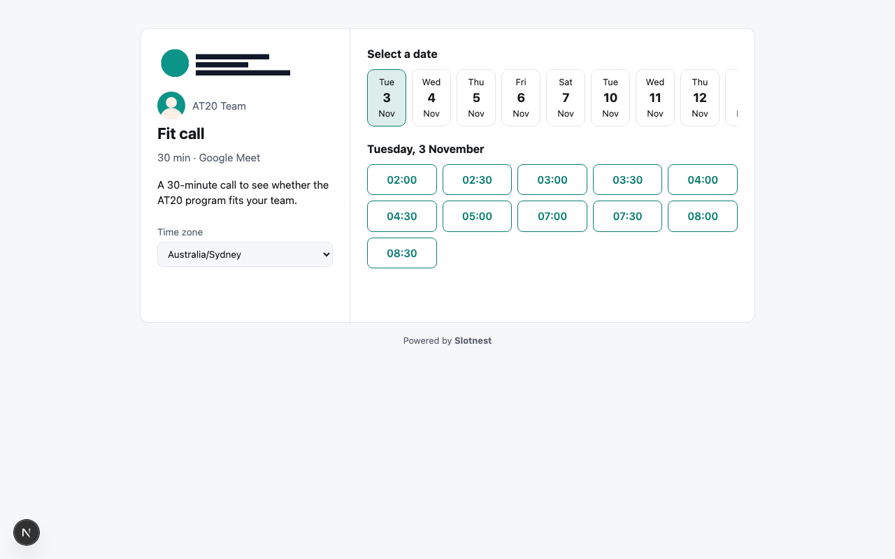

# Slotnest

Open-source appointment booking for small teams: public booking pages, calendar invites, reminders, round-robin and
collective team meetings, routing forms and webhooks. Run it yourself with Docker, or use the hosted version at
[slotnest.at20.ai](https://slotnest.at20.ai). Made by [AT20 AI](https://at20.ai).



## Run your own

You need a server with Docker and a domain (or subdomain) pointed at it. Then:

```bash
git clone <this repository> slotnest && cd slotnest
scripts/selfhost.sh book.example.com
```

This builds the app and starts it with Postgres and Caddy, which gets the HTTPS certificate. The first run writes
`deploy/.env` with a generated database password and encryption key; keep a copy of that file.
- **Sign in:** open `/login` and enter your email. Until email is set up, the sign-in link is printed in the app's log
  (the script shows the command).
- **Email:** set `EMAIL_PROVIDER=smtp` and `SMTP_URL` in `deploy/.env` so invitees get confirmations, calendar invites
  and reminders (SETUP.md §2). Then run `scripts/selfhost.sh` again to restart.
- **Your details:** set `COMPANY_NAME`, `CONTACT_EMAIL` and `ADMIN_EMAILS`. The bundled privacy policy and terms name
  your company; review them, they're a starting point, not legal advice.
- **Calendars, video and payments:** Google Calendar, Microsoft 365, Zoom and Stripe each need your own keys; SETUP.md
  says how. Without Stripe, every account gets every feature, with no seat limits.
- **Updates:** `git pull && scripts/selfhost.sh`. Database migrations run when the app starts.
- **Backups:** `deploy/backup.sh` dumps the database and uploaded images (written for `/opt/slotnest`; adjust the path).

To try it on your own machine, use `scripts/selfhost.sh localhost` and accept the browser's certificate warning.

## Develop

```bash
npm install
npm run db:up        # Postgres 16 (localhost:5446) and the Mailpit inbox (http://localhost:8026)
npm run db:migrate
npm run db:seed      # host "at20" (host@example.test) with a 30-minute "fit-call" event, plus team "at20-sales"
                     # (at20 and sam@example.test) with a round-robin "demo" and a collective "kickoff"
npm run dev          # http://localhost:3100/at20/fit-call and http://localhost:3100/at20-sales/demo
```

Copy `.env.example` to `.env.local` and set `TOKEN_ENCRYPTION_KEY` (`openssl rand -base64 32`).
- **Sign in as a host:** go to `/login`, enter `host@example.test`, and open the link from Mailpit. A new email address goes through onboarding instead.
- **Tests:**
  - `npm test` runs the unit tests: slot engine, .ics, encryption.
  - `npm run test:int` runs the database tests: double booking, round-robin (concurrency, even distribution, invites), collective events and Stripe webhooks.
  - `npm run typecheck` runs the TypeScript checker.

## Features

| Feature | Status |
|---|---|
| Event types, weekly hours, date overrides, buffers, notice, booking window, daily cap | Done (dashboard) |
| Time-zone-correct slots across daylight-saving changes | Done (29 engine tests) |
| Double-booking protection (exclusion constraint, per-host lock, re-check) | Done (concurrency test) |
| Public booking page and embeddable widget (`/embed.js`, inline or popup) | Done |
| Email confirmations with `.ics` (REQUEST, then CANCEL; stable UID and increasing SEQUENCE) | Done (works with Mailpit; Resend over SMTP in production) |
| Reminders (default 24h and 1h before; pg-boss jobs, stale reminders dropped) | Done; customisable per event type |
| Self-service reschedule and cancel (`/b/{id}?t={token}`); host cancel from dashboard | Done |
| Host sign-in (magic link), onboarding, dashboard | Done |
| Google Calendar free/busy and event write, Google Meet links | Built; needs Google OAuth credentials |
| Microsoft 365 free/busy and event write | Built; needs an Entra app registration |
| Zoom meeting links | Built; needs a Zoom OAuth app |
| Billing: one-time setup fee plus yearly maintenance (Stripe Checkout, webhooks, portal, Free plan limits) | Built; needs Stripe keys |
| Per-account branding: logo, profile photo, brand colour with automatic AA contrast (light and dark), on booking page, manage page, embed and invitee emails | Done (dashboard → Branding) |
| "Powered by Slotnest" mark, which paid accounts can hide | Done; follows billing, or `UNBILLED_PAID_FEATURES` while billing is off |
| Teams: team page, email invites (accepted only by the invited address), members, seats | Done (dashboard → Team) |
| Round-robin event types at `/{team}/{event}`: shows times when any chosen member is free, assigns by equal distribution | Done (concurrency and distribution tests) |
| Collective event types: every chosen member joins one meeting, offered only when all are free; each gets the event on their own calendar and the host emails | Done (concurrency, reschedule and cancel tests) |
| Custom booking questions (short answer, paragraph, phone, dropdown; up to 10), shown in host emails, calendar events, dashboard and webhooks | Done (event type → Booking questions) |
| Public profile page `/{handle}` listing event types; hidden event types are bookable by link only | Done |
| Redirect after booking to your own page, optionally with name, email and time; prefill with `?name=&email=` | Done (works in embeds via `embed.js`) |
| Webhooks: `booking.created`, `booking.rescheduled`, `booking.cancelled`; HMAC-SHA256 signed, retried, public https addresses only | Done (dashboard → Webhooks) |
| Group events: several invitees per time slot (classes, webinars), seats counted down, one shared calendar event and video link per session | Done (event type → People per time slot; concurrency test) |
| Reminder workflows: per event type, any number of reminders before and follow-ups after, to invitee or host, with optional custom wording and placeholders | Done (event type → Reminders and follow-ups) |
| Paid bookings: hosts connect Stripe (Connect, direct charges), set a price; invitees pay in Checkout; slot held while paying; automatic refunds on cancel | Built; needs Connect enabled on the Stripe account |

## Layout

| Path | What |
|---|---|
| `src/lib/availability/` | Pure slot engine and its DST/time-zone tests. |
| `src/lib/booking/service.ts` | Slots, create, reschedule and cancel (lock, re-check, constraint). |
| `src/lib/integrations/` | OAuth (Google, Microsoft, Zoom), encrypted token storage and refresh, free/busy, event writes, Zoom meetings. |
| `src/lib/jobs/` | pg-boss queue, worker, and booking side effects (calendar, video, email, reminders). |
| `src/lib/email/` | `.ics` builder (RFC 5545), templates, and the log/SMTP/Postmark sender. |
| `src/lib/billing/` | Stripe Checkout, portal and webhooks; booking-page gating. |
| `src/lib/auth/` | Magic-link sign-in and sessions. |
| `src/lib/teams/` | Teams, members, invites, seat coverage, the public identity of team event types, and round-robin host picking. |
| `src/lib/branding/` | Brand colour contrast maths, image validation by content, asset storage (local disk, swappable for S3/Spaces), and the paid-only "Powered by" rule. |
| `app/` | Booking page, manage page, dashboard and API routes. |
| `db/migrations/` | SQL schema, the source of truth. |
| `public/embed.js` | Embeddable widget (demo at `/embed-demo.html`). |

## Known limits (next)

- Custom domains for booking pages: not built yet.
- Brand images aren't resized or re-encoded (no image library yet). The 1 MB and 4096 px limits keep them reasonable, and pages and emails scale them down with width/height.
- In `npm run dev`, the background worker keeps the job code it loaded at startup. After editing `src/lib/jobs` or the email templates, restart the dev server (or touch `next.config.ts`) before testing emails.

- Round-robin and collective:
  - A rescheduled meeting keeps its hosts, so only times they're all free are offered.
  - A member who leaves or is removed keeps their existing bookings.
  - No per-host priority or weighting yet; equal distribution only.
- Teams: one team per owner; only the owner manages members and team event types. The team uses the owner's logo and colour.
- Collective events:
  - Shared times are found on a 5-minute grid, then spaced by the event's interval. Weekly hours that start off a 5-minute boundary (09:07) can hide a few times.
  - The organizer (the owner if they're a host, otherwise the first host) provides the Zoom or Meet link. The other hosts' calendar events carry that link in their description.
- Calendar choice is the primary calendar only.
- Free/busy results aren't cached yet.
- If a calendar provider fails, its busy times are skipped instead of blocking bookings. The failure is shown on the dashboard.
- Host calendar events don't list the invitee as an attendee, on purpose, so Google and Microsoft don't send a second, conflicting invite.
- Embedded widget: if the visitor's system is in dark mode and the host page is light, the iframe may paint an opaque background.

## Licence

Apache License 2.0: see [LICENSE](LICENSE) and [NOTICE](NOTICE). Copyright 2026 AT20 AI Inc.
